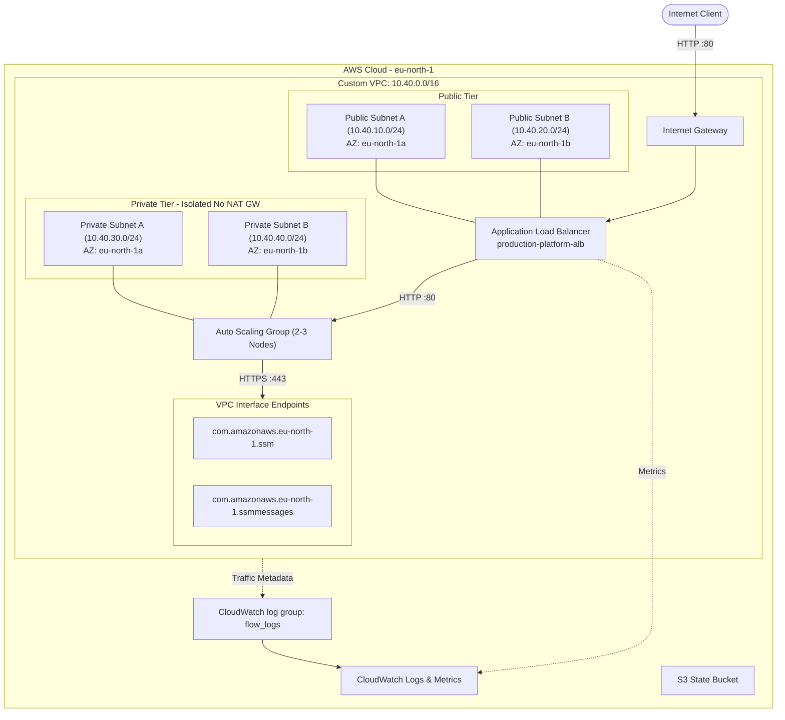
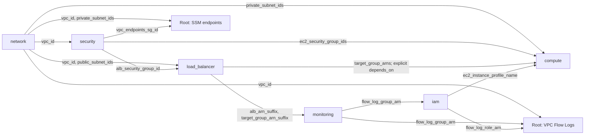

# System Architecture & Technical Specifications

This document describes the configuration in Terraform, not a verified snapshot of live AWS resources. Addressing below matches the local `environments/lab/terraform.tfvars`; deployments with different input values will differ. Runtime evidence is tracked in [README.md](../README.md#verification-evidence).

---

## 1. Network Topology & Addressing

The network layer provides network-level isolation, multi-AZ resilience, and strict segregation between public and private tiers.



### IP Allocation Table

| Subnet Identifier | CIDR Block | Availability Zone | Route Table Target | Map Public IP |
| --- | --- | --- | --- | --- |
| `production-platform-public-1` | `10.40.10.0/24` | `eu-north-1a` | `0.0.0.0/0` -> Internet Gateway | `false` |
| `production-platform-public-2` | `10.40.20.0/24` | `eu-north-1b` | `0.0.0.0/0` -> Internet Gateway | `false` |
| `production-platform-private-1` | `10.40.30.0/24` | `eu-north-1a` | Local VPC route only | `false` |
| `production-platform-private-2` | `10.40.40.0/24` | `eu-north-1b` | Local VPC route only | `false` |

### Routing & Egress Characteristics

- **Public Subnets**: Associated with `production-platform-public-rt`, containing an explicit default route pointing to `aws_internet_gateway.main`.
- **Private Subnets**: Associated with `production-platform-private-rt`. Contains **no default route**. External internet access is blocked at the routing layer.
- **DNS Configuration**: Both `enable_dns_hostnames` and `enable_dns_support` are set to `true` to facilitate private DNS resolution for VPC Interface Endpoints.

---

## 2. Ingress & Traffic Management

### Application Load Balancer

- **Type**: Internet-facing Application Load Balancer spanning both public subnets.
- **Header Sanitization**: Configured with `drop_invalid_header_fields = true` to drop malformed or potentially malicious HTTP headers before forwarding.
- **Listener Configuration**:
  - Port: `80` (HTTP)
  - Default Action: Forward to `aws_lb_target_group.app`
- **Target Group & Health Checking**:
  - Target Type: `instance`
  - Protocol & Port: `HTTP:80`
  - Health Check Endpoint: `GET /`
  - Healthy Threshold: 2 consecutive successes
  - Unhealthy Threshold: 3 consecutive failures
  - Check Interval: 30 seconds (Timeout: 5 seconds)
  - Success Matcher: HTTP `200`

---

## 3. Compute & Auto Scaling

### Launch Template (`aws_launch_template.app`)

- **AMI Resolution**: Terraform resolves the latest Amazon Linux 2023 x86_64 AMI from SSM Parameter Store when evaluating the configuration:
  `/aws/service/ami-amazon-linux-latest/al2023-ami-kernel-6.1-x86_64`
- **Instance Type**: `t3.micro` (burstable general-purpose).
- **Metadata Protection**: Enforces IMDSv2 via `http_tokens = "required"` and `http_endpoint = "enabled"`.
- **Runtime Initialization (User Data)**:
  - Generates the landing page at `/opt/platform-app/index.html`.
  - Configures a dedicated systemd service unit (`/etc/systemd/system/platform-app.service`).
  - Runs a lightweight Python HTTP server bound to `0.0.0.0:80`.
  - Enables and starts the unit with automatic restart on failure.
  - Runs as root with no explicit systemd sandboxing. The AMI must already contain Python because user-data does not install packages.

### Auto Scaling Group

- **Capacity**: `desired_capacity = 2`, `min_size = 2`, `max_size = 3`.
- **Subnet Placement**: Both private subnets are configured. Auto Scaling attempts balanced placement across their AZs; availability must be verified with runtime tests.
- **Health Check Type**: `ELB` (with a 300-second grace period for initialization).
- **Scaling Policy**: Target tracking scaling policy (`TargetTrackingScaling`) with a 60% target for average CPU utilization (`ASGAverageCPUUtilization`).

---

## 4. Security Group Micro-segmentation

Inter-resource network communication is governed by chained security groups using discrete ingress/egress rules:

```text
[Internet: 0.0.0.0/0]
         │  Ingress TCP :80
         ▼
┌──────────────────────────────────────────────┐
│  production-platform-alb-sg                  │
│  - Ingress: 0.0.0.0/0 :80                    │
│  - Egress:  production-platform-ec2-sg :80   │
└──────────────────────────────────────────────┘
         │  Egress TCP :80 to EC2 SG
         ▼
┌──────────────────────────────────────────────┐
│  production-platform-ec2-sg                  │
│  - Ingress: production-platform-alb-sg :80   │
│  - Egress:  production-platform-vpcep-sg :443│
└──────────────────────────────────────────────┘
         │  Egress TCP :443 to VPC Endpoints SG
         ▼
┌──────────────────────────────────────────────┐
│  production-platform-vpc-endpoints-sg        │
│  - Ingress: production-platform-ec2-sg :443  │
└──────────────────────────────────────────────┘
```

The default security group (`default`) in the VPC is imported via Terraform and stripped of all rules to prevent accidental exposure if resources are spawned without explicit group bindings.

---

## 5. Private Administrative Access (SSM)

Because no public SSH port or NAT Gateway exists, administrative shell access is provided via AWS Systems Manager:

1. **VPC Interface Endpoints**:
   - `com.amazonaws.eu-north-1.ssm`
   - `com.amazonaws.eu-north-1.ssmmessages`
   - Deployed into private subnets with `private_dns_enabled = true`.
2. **EC2 IAM Role**:
   - Attached policy: `arn:aws:iam::aws:policy/AmazonSSMManagedInstanceCore`.
3. **Operator Authorization (ABAC)**:
   - IAM policy `production-platform-ssm-operator` enforces tag-based condition keys:
     - `ssm:resourceTag/Project == "AWS_Platform_IaC"`
     - `ssm:resourceTag/Environment == "lab"`
   - The policy grants document access to `SSM-SessionManagerRunShell` and terminate/resume permissions for session ARNs matching `session/&{aws:userid}-*`.
   - Terraform creates this policy but does not attach it to an operator identity. Verify effective permissions using an identity with the intended policy attachments, including both allowed and denied cases.
   - Session command/output logging to CloudWatch Logs or S3 is not configured in this repository. See [AWS session logging documentation](https://docs.aws.amazon.com/systems-manager/latest/userguide/session-manager-logging.html).

---

## 6. Observability & Telemetry

### VPC Flow Logs

- **Scope**: Captured on the entire VPC (`traffic_type = "ALL"`).
- **Destination**: CloudWatch Log Group (`flow_logs`).
- **Retention**: 7 days for the lab; no compliance retention requirement has been established.
- **Service Role**: `logs:CreateLogStream`, `logs:PutLogEvents`, and `logs:DescribeLogStreams` are scoped to the group; `logs:DescribeLogGroups` uses `Resource = "*"`.

### CloudWatch Dashboard & Alarms

- **Dashboard**: `production-platform-dashboard` rendering real-time metrics for:
  - Healthy EC2 Target Count (`HealthyHostCount`)
  - HTTP 5XX Target Errors (`HTTPCode_Target_5XX_Count`)
  - Total Target Request Count (`RequestCount`)
- **Alarms**:
  - `production-platform-healthy-targets`: Triggers if healthy hosts fall below 2 over two evaluation periods.
  - `production-platform-http-5xx`: Triggers if any 5XX server errors occur across two consecutive periods.
  - Both alarms use 60-second periods. Missing data is treated as breaching for healthy targets and not breaching for 5XX errors.
  - No notification actions are configured; an alarm state change alone does not notify an operator.

---

## 7. Terraform Module Dependency Flow

The root environment (`environments/lab`) wires six modules:

Arrows point from the producer of an output to its consumer.



The SSM endpoints and VPC Flow Logs are resources in `environments/lab`, outside the six modules. The S3 state bucket is provisioned separately by `bootstrap/`.
